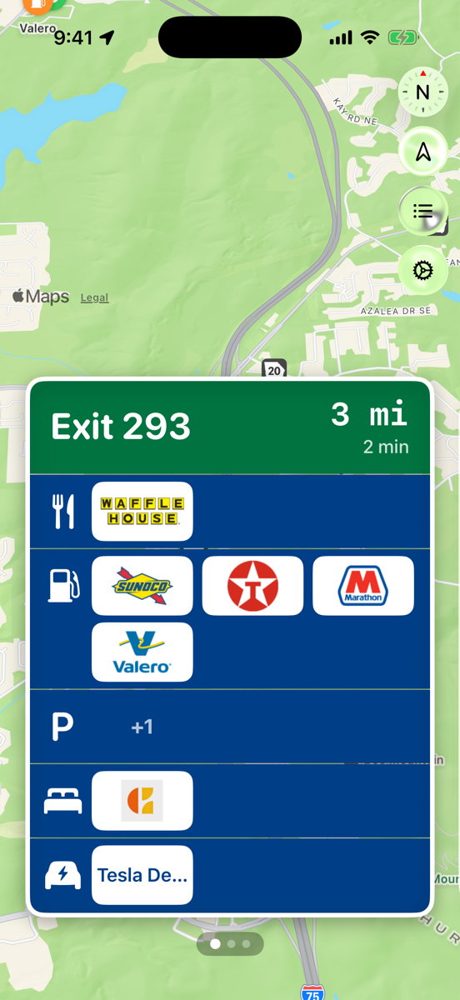
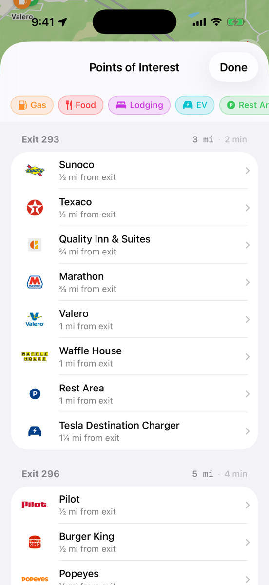
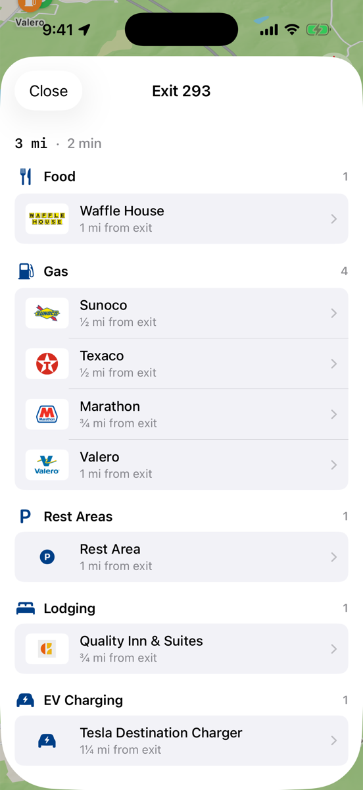
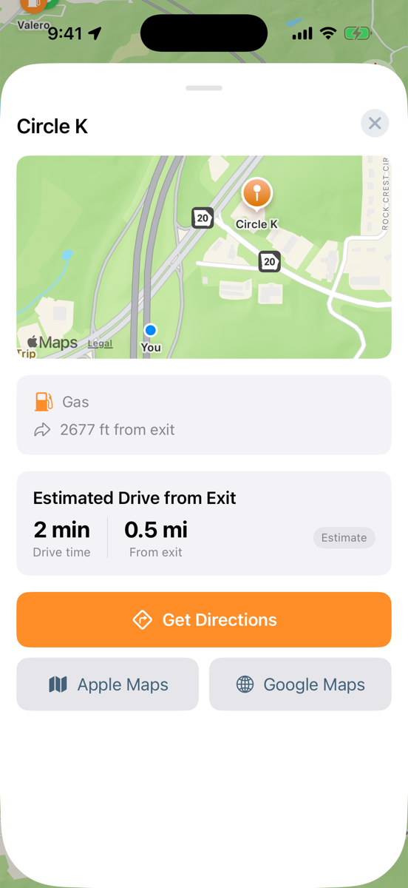

<p align="center">
  
</p>

<h1 align="center">Pike</h1>

<p align="center">
  What's at the next exit, like the blue logo signs on the interstate.
</p>

<p align="center">
  <a href="https://thepike.app">thepike.app</a> ·
  <a href="https://apps.apple.com/us/app/pike-next-exit-guide/id6759123383">App Store</a>
</p>

<p align="center">
  
  
  
  
</p>

## About

Open Pike on the road and it works out which interstate you're on and which way you're headed, then lines up every exit ahead of you with its gas, food, lodging, EV charging, rest areas, and parks.

- **Works without a signal:** all exit data ships inside the app.
- **Private:** your location stays on your device, with no account and no ads.
- **Built for the passenger seat:** swipe through exits, see the detour for each stop, and open it in Apple Maps or Google Maps.

Pike covers interstate highways across the continental US.

## Build

Requires Xcode and the [GitHub CLI](https://cli.github.com/), signed in with `gh auth login`.

```bash
./build.sh --fetch-pack   # download the data pack pinned in build.sh
./build.sh                # build for the simulator
```

Open `Pike.xcodeproj` to run it. Set your own team under Signing & Capabilities to run on a device.

## Data

The data pack is built from two releases:

1. [`openinterstate`](https://github.com/tldev/openinterstate): interstate corridors, exits, and places, derived from OpenStreetMap.
2. [`openinterstate-reachability`](https://github.com/tldev/openinterstate-reachability): OSRM drive-time scores.

`pike-export` in `server/` combines them into `pike.sqlite`. The Build Pack workflow runs this and publishes a `pack-*` release.

Map data © OpenStreetMap contributors, available under the Open Database License (ODbL).

## Contributing

See [AGENTS.md](AGENTS.md) for architecture and workflow notes.

## License

Pike's source code is available under the [MIT License](LICENSE). The license does not cover:

- **Map data:** the data pack is derived from OpenStreetMap and is available under the [Open Database License](https://opendatacommons.org/licenses/odbl/).
- **Brand logos:** the logos in `Pike/Assets.xcassets` are trademarks of their respective owners and are included only to identify those businesses.
